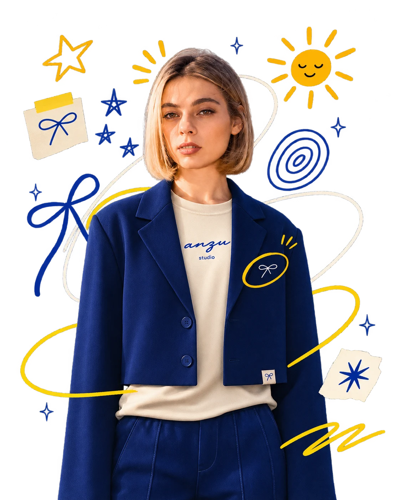
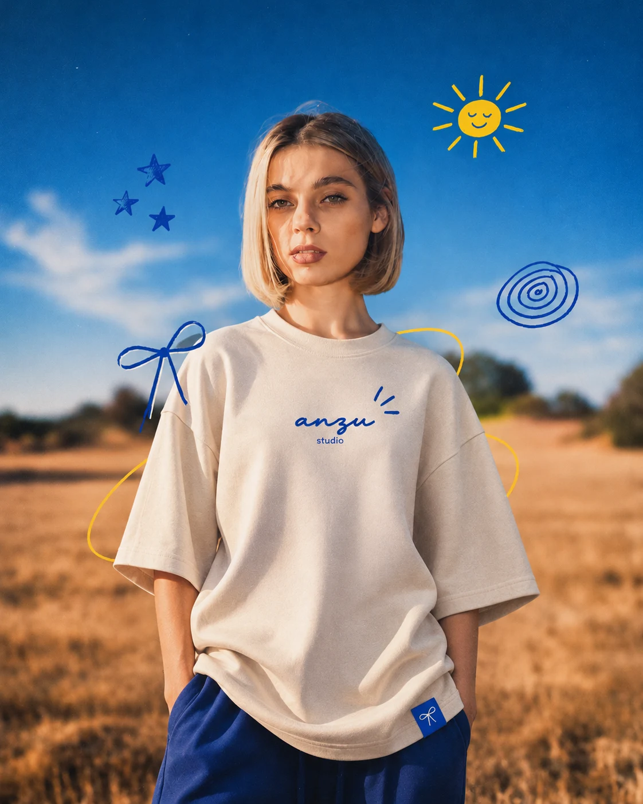

<div align="center">

# A N Z U

**Uma galeria em movimento.**

Cada coleção tem um artista por trás.


[Conheça o projeto](#o-projeto) · [Rode localmente](#como-rodar) · [Explore o código](#estrutura) · [Veja o que falta](#próximos-passos)




*Imagens editoriais utilizadas no site.*

</div>

## O projeto

Anzu é uma casa de muitas mãos. Cada coleção nasce de um artista da nossa curadoria, que chega com o seu traço, a sua cor e o seu jeito de olhar, e nós abrimos espaço para isso virar roupa.

Este repositório reúne o site da **Anzu studio**: apresentação da marca, catálogo de peças e uma experiência de navegação com identidade editorial, fotos e grafismos.

O projeto está na etapa de **front-end**, com conteúdo local. A compra, a autenticação e o envio do formulário ainda são demonstrativos. Não há integração com pagamentos ou banco de dados.

## O que você encontra

| Recurso | Como funciona hoje |
| --- | --- |
| Página inicial | Apresentação da marca, faixa ligada à rolagem e destaques da coleção. |
| Carrossel de produtos | Foto, nome, preço, favoritos e link para cada peça; navegação por setas e rolagem horizontal. |
| Catálogo e detalhes | Dados locais, galeria de fotos, seleção de tamanho e seções expansíveis de medidas, composição, artista e cuidados. |
| Busca | Filtra nomes e descrições, ignora acentos e mostra miniaturas e preços. |
| Favoritos | Salva as peças no `localStorage` e sincroniza a lista entre abas. Se o armazenamento estiver bloqueado, mantém as escolhas na visita atual. |
| Sobre | Texto de apresentação da marca e composição editorial. |
| Contato | Formulário demonstrativo: valida os campos, mas não envia e-mails. |
| Login | Simulação de entrada, sem autenticação, envio ou armazenamento de credenciais. |
| WhatsApp | Botão flutuante com acesso direto à conversa configurada. |

O código inclui rótulos acessíveis, foco visível, atalho para o conteúdo e tratamento de movimento reduzido. Os componentes se adaptam a diferentes larguras de tela.

## Como rodar

### Pré-requisitos

- **Node.js 24**, versão usada na validação local.
- **npm**, para instalar e executar as dependências.
- **Git**, para clonar o repositório.

```bash
git clone https://github.com/gushenri/anzu-studio.git
cd anzu-studio
npm ci
npm run dev
```

Abra **[http://localhost:3000](http://localhost:3000)**. Se a porta estiver ocupada, confira o endereço informado no terminal.

Não é necessário configurar variáveis de ambiente para usar a versão atual. As fontes são locais e não dependem de download durante a compilação.

### Comandos disponíveis

| Comando | Para que serve |
| --- | --- |
| `npm run dev` | Inicia o servidor de desenvolvimento. |
| `npm run typecheck` | Verifica os tipos com TypeScript, sem gerar arquivos de aplicação. |
| `npm run build` | Gera a compilação de produção e as páginas pré-renderizadas. |
| `npm start` | Executa a compilação de produção; requer `npm run build` antes. |

Para conferir a versão de produção localmente:

```bash
npm run build
npm start
```

O projeto usa Next.js com pré-renderização. Não há configuração de exportação HTML independente; para produção, use um ambiente compatível com Next.js e Node.js.

## Páginas

| Rota | Conteúdo |
| --- | --- |
| `/` | Página inicial. |
| `/shop` | Catálogo da coleção. |
| `/shop/[slug]` | Detalhes de cada peça; por exemplo, `/shop/camiseta-intervalo`. |
| `/about` | Apresentação da Anzu studio. |
| `/contact` | Contato demonstrativo. |

## Estrutura

```text
app/
├── about/              # Apresentação da marca
├── contact/            # Página de contato
├── fonts/              # Fontes locais e suas licenças
├── shop/[slug]/        # Detalhes das peças
├── globals.css         # Paleta, estilos e responsividade
├── layout.tsx          # Estrutura compartilhada das páginas
└── page.tsx            # Página inicial
components/
├── graphics/           # Ícones e desenhos em SVG
├── editorial-carousel.tsx # Carrossel atual de produtos
├── favorites-provider.tsx # Estado e persistência dos favoritos
├── header-actions.tsx  # Login, busca e favoritos
├── product-card.tsx    # Cartão compartilhado pela grade e carrossel
├── product-details.tsx # Informações técnicas e autoria
└── ...                 # Galeria, formulários, cabeçalho e rodapé
lib/
└── collection.ts       # Catálogo e modelos de dados
public/
├── graphics/           # Grafismos usados no site
└── images/             # Fotos usadas no site
```

## Personalize o conteúdo

- **Peças, preços e fotos:** edite [`lib/collection.ts`](lib/collection.ts). O `slug` define o endereço da peça e deve ser único. Use pelo menos uma foto por produto e descreva-a em `alt`.
- **Artistas:** preencha `artist.name` e `artist.bio` na peça correspondente à coleção.
- **Informações técnicas:** preencha `details.composition`, `details.care` e `details.measurements`, com tamanho, largura e comprimento em centímetros.
- **Apresentação da marca:** [`app/about/page.tsx`](app/about/page.tsx).
- **Cores e estilos globais:** [`app/globals.css`](app/globals.css).
- **WhatsApp:** altere o destino em [`components/whatsapp-button.tsx`](components/whatsapp-button.tsx), usando o número internacional no formato `https://wa.me/55DDDNÚMERO`, sem espaços ou símbolos.
- **Créditos e canais de contato:** [`components/site-footer.tsx`](components/site-footer.tsx).

### Identidade visual

| Cor | Código |
| --- | --- |
| Azul | `#022E99` |
| Marinho | `#03235E` |
| Grafite | `#292929` |
| Off-white | `#F5F4F0` |
| Sol | `#FFD23F` |

As fontes **Outfit** e **Kaushan Script** são carregadas localmente com `next/font`. O movimento utiliza **Framer Motion**, com atenção à preferência por movimento reduzido.

## Próximos passos

- [ ] TODO: Confirmar os dados finais do catálogo, incluindo nomes, preços e tamanhos.
- [ ] TODO: Preencher artistas, medidas, composição e cuidados de cada peça.
- [ ] TODO: Confirmar e-mail e redes sociais oficiais.
- [ ] TODO: Integrar o formulário de contato a um serviço de envio.
- [ ] TODO: Implementar autenticação real, quando essa etapa for iniciada.
- [ ] TODO: Definir o fluxo real de compra, pedidos e pagamentos.

Os pontos ainda pendentes estão marcados com `TODO` no código e, quando necessário, com placeholders entre colchetes na interface.

## Arquivos e direitos de uso

Somente os assets utilizados pelo site estão em `public/`. Pastas de pesquisa, imagens originais e o PDF de identidade visual ficam fora do versionamento, assim como dependências, arquivos de build e configurações locais.

Este repositório não inclui uma licença geral de uso ou redistribuição do código e dos assets. A publicação do repositório não representa uma licença aberta para a identidade ou as imagens da Anzu studio. As licenças das fontes estão em [`app/fonts/`](app/fonts/).

---

<div align="center">

**Anzu studio. Uma galeria em movimento.**

Desenvolvido por [Gustavo Henrique](https://github.com/gushenri).

</div>
